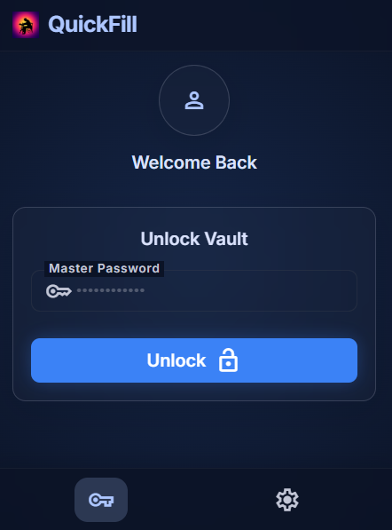
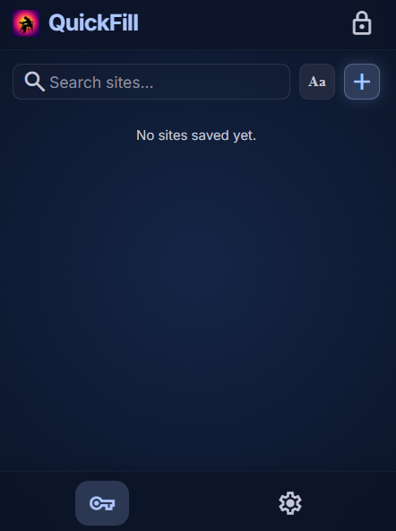
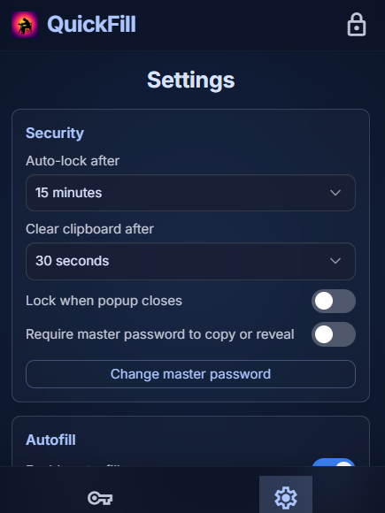

# QuickFill

QuickFill is a lightweight password manager and login autofill extension for Google Chrome. It is built entirely with vanilla HTML, CSS, and JavaScript on Manifest V3, and stores your vault encrypted in the browser using the Web Crypto API.

> **Status:** This is a personal project and has not been independently security-audited. Review the code and keep encrypted backups before trusting it with important credentials.

<p align="center">
  
  
  
</p>

## What it does

- **Encrypted local vault** — credentials are encrypted with AES-GCM (256-bit) before being written to `chrome.storage.local`.
- **Master password** — the vault key is derived from your master password with PBKDF2 (SHA-256, 100,000 iterations, random 16-byte salt). You can change the master password from Settings; the vault is re-encrypted with a new salt and key.
- **Session-only key** — the derived key is kept in `chrome.storage.session`, so it is cleared when the browser restarts. A manual lock button clears it immediately, and an optional auto-lock timer locks the vault after the configured timeout.
- **Credential management** — add, edit, search, and delete entries from the popup. Each entry stores a name, domain, username, and password.
- **Manual fill** — click the fill button on an entry to insert the username and password into the current tab's login form, including forms inside iframes.
- **Optional auto-fill** — enable the per-site toggle and QuickFill will fill visible, empty password fields when a matching login form appears, including forms injected later by single-page apps or modals.
- **Domain detection and favicons** — the current tab's hostname is pre-filled when adding an entry, and site icons are loaded for the list.
- **Open site, copy, and generate** — open a saved site in a new tab, copy the username or password, and generate strong passwords from the list or the add/edit form.
- **Encrypted backup** — export the encrypted vault as JSON and restore it later without exposing plaintext credentials.
- **Themes and languages** — switch between light and dark with the sun/moon toggle, plus English and Turkish UI. The initial default follows your system preference.
- **No auto-submit** — QuickFill fills fields but never submits a form.

## Security notes

- The vault (`vaultData`, containing ciphertext and IV) and salt (`vaultSalt`) live in local storage; plaintext credentials are never persisted.
- The master password and derived key are never logged or sent to a server.
- Auto-lock is configurable (never, 1, 5, 15, or 30 minutes). The vault can also lock when the popup closes. The session key is always cleared on browser restart.
- Auto-fill matches the exact saved hostname by default. Subdomain matching is opt-in and only accepts a subdomain of the saved host — never arbitrary substring matches.
- A setting can require the master password before copying or revealing a credential.
- The clipboard is cleared after a configurable delay (never, 5, 10, or 30 seconds) when copying.
- Manual fill is user-directed. Only fill a page you trust, and prefer HTTPS sites; credentials entered on an HTTP page can be read in transit.
- Favicons are fetched from Google's favicon service, which reveals the domains you have saved to that service.
- QuickFill does not protect against a compromised browser profile, malicious extensions, keyloggers, or a site after credentials have been filled. It is not a substitute for a professionally audited password manager.
- To report a vulnerability, use GitHub's private vulnerability reporting for this repository. Do not open a public issue containing exploit details or real credentials.
- See [PRIVACY.md](PRIVACY.md) for the full privacy policy.

## Known limitations

- The minimum master password length is four characters for backward compatibility. Choose a long, unique passphrase.
- PBKDF2 uses 100,000 SHA-256 iterations. The vault format and parameters are not migrated automatically.
- Manual fill sends the selected credential to the active tab and does not verify that the tab's host matches the saved entry. Use the per-site auto-fill toggle when you want host-matched delivery.
- There is no automated browser test suite yet; validate changes manually with fake credentials.

## Installation

QuickFill is not published to the Chrome Web Store; load it as an unpacked extension:

1. Clone or download this repository.
2. Open Chrome and go to `chrome://extensions/`.
3. Enable **Developer mode** (top-right).
4. Click **Load unpacked** and select this folder (the one containing `manifest.json`).
5. Pin the QuickFill icon to the toolbar.

QuickFill requires Chrome 109 or newer.

## Usage

1. **Create the vault** — open the popup and choose a master password (at least 4 characters). It cannot be recovered if lost.
2. **Add an entry** — click `+`, then fill in the site name, domain, username, and password. The domain of the active tab is suggested automatically. Use the `Aa` button to generate a password and watch the strength meter.
3. **Fill a login form** — open a site's login page and either:
   - click the fill (login) icon on the matching entry in the popup,
   - press `Alt+Shift+F` to fill the current site, or
   - enable the auto-fill toggle for that entry and reload/open the login page.
4. **Manage entries** — use the search box to filter by name, URL, or username, copy the username or password, open the saved site, edit an entry, or delete it.
5. **Settings** — open the settings tab to change the master password, auto-lock and clipboard timeouts, auto-fill behavior, theme, and language; manage sites with auto-fill enabled; export or restore an encrypted backup; or reset the vault.
6. **Lock the vault** — click the lock icon in the popup header. You will need the master password to unlock it again.

Enabling auto-fill for an entry turns it off for other entries with the same host.

## Keyboard shortcuts

| Shortcut | Action |
| --- | --- |
| `Alt+Shift+Q` | Open the QuickFill popup |
| `Alt+Shift+F` | Fill the current site with the matching saved entry |

Shortcuts can be changed at `chrome://extensions/shortcuts`.

## Project structure

| Path | Purpose |
| --- | --- |
| `manifest.json` | MV3 manifest: permissions, commands, service worker, popup, content script. |
| `popup/` | Vault UI: setup, unlock, entry list, add/edit forms, settings, modals. |
| `popup/i18n.js` | English and Turkish UI strings. |
| `background/background.js` | Service worker: message routing, auto-lock, domain matching, script injection, clipboard, commands. |
| `content/content-script.js` | Detects login forms on pages, writes credentials, and shows the fill toast. |
| `offscreen/` | Offscreen document used to copy credentials and clear the clipboard after a timeout. |
| `lib/crypto.js` | PBKDF2 key derivation and AES-GCM encrypt/decrypt helpers. |
| `lib/storage.js` | Promise wrappers around `chrome.storage.local` and `chrome.storage.session`. |
| `lib/settings.js` | Settings defaults, validation, and hostname matching. |
| `images/` | Extension icon and screenshots. |
| `PRIVACY.md` | Privacy policy and network-request disclosure. |
| `LICENSE` | ISC license. |

## Permissions

QuickFill requests `storage`, `activeTab`, `scripting`, `alarms`, `offscreen`, and `clipboardWrite`, and registers its content script on `<all_urls>` so it can detect login forms on any site you visit. It makes no network requests of its own except for favicon images. See [PRIVACY.md](PRIVACY.md) for details.

## Development

The extension runs directly from source — there is no build step required to load it. Tailwind CSS is used only at development time to generate `popup/popup.css`; runtime code is plain JavaScript with no framework or bundler.

To rebuild the popup stylesheet after changing `popup/input.css` or `tailwind.config.js`:

```bash
npm install
npx tailwindcss -i popup/input.css -o popup/popup.css
```

There is no automated test suite yet (`npm test` is a placeholder). Validate changes by reloading the unpacked extension in `chrome://extensions/` and testing with fake credentials.

## License

QuickFill is released under the [ISC License](LICENSE).
